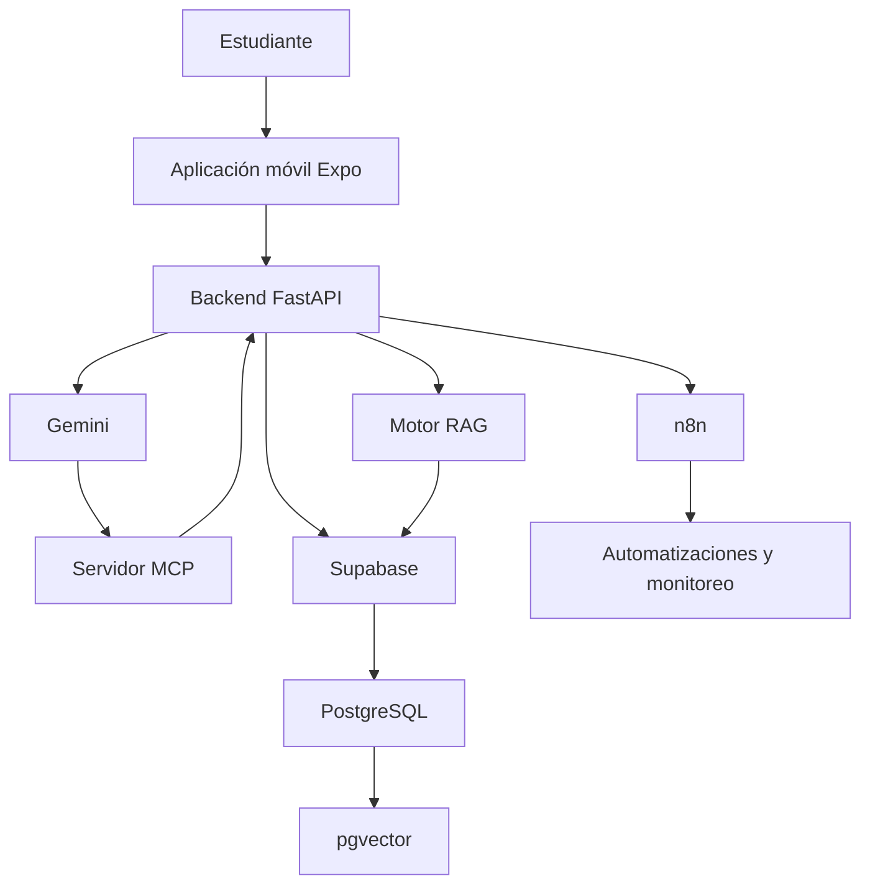

# iBanú – Chatbot de orientación académica

**Sistema de orientación académica para estudiantes de Ingeniería de Sistemas.**

iBanú es una plataforma de orientación académica que permite a los estudiantes realizar consultas en lenguaje natural sobre información académica e institucional. Integra inteligencia artificial, herramientas de consulta de información estructurada y recuperación de información documental para ofrecer respuestas claras y contextualizadas.

El proyecto fue desarrollado utilizando tecnologías de backend, bases de datos, inteligencia artificial, automatización y desarrollo móvil.

---

## Autores

- **Karol Stefany Saavedra Suárez**
- **Edson Julián Díaz Pinilla**

---

## 1. Objetivo del proyecto

Desarrollar un chatbot académico que facilite el acceso a información relacionada con el programa de Ingeniería de Sistemas, permitiendo consultar datos académicos y resolver inquietudes mediante una interfaz conversacional.

### Objetivos específicos

- Implementar una base de datos académica con PostgreSQL y Supabase.
- Desarrollar un backend para gestionar las consultas académicas.
- Integrar Gemini para interpretar preguntas y generar respuestas.
- Implementar un servidor MCP para conectar el modelo con herramientas de consulta.
- Incorporar recuperación de información documental mediante RAG.
- Integrar automatizaciones y monitoreo mediante n8n.
- Desarrollar una aplicación móvil para interactuar con el chatbot.
- Incorporar mecanismos de seguridad y guardrails para mantener el enfoque académico.

## 2. Arquitectura del sistema

La arquitectura de iBanú está compuesta por diferentes servicios que trabajan de manera integrada.

### Diagrama general



### Componentes principales

| Componente | Tecnología | Función |
|---|---|---|
| Aplicación móvil | React Native y Expo | Interfaz de interacción con el estudiante. |
| Backend | Python y FastAPI | Gestiona las solicitudes y consultas del chatbot. |
| Inteligencia artificial | Google Gemini | Interpreta preguntas y construye respuestas. |
| Servidor de herramientas | MCP y FastMCP | Expone herramientas de consulta académica al modelo. |
| Base de datos | Supabase y PostgreSQL | Almacena la información académica estructurada. |
| Extensión vectorial | pgvector | Permite trabajar con representaciones vectoriales. |
| Recuperación documental | RAG | Recupera información relevante de documentos académicos. |
| Automatización | n8n | Gestiona flujos de automatización y monitoreo. |
| Infraestructura | Microsoft Azure | Aloja los servicios del proyecto. |

### Flujo general de funcionamiento

1. El estudiante realiza una pregunta desde la aplicación móvil.
2. El backend recibe la solicitud y conserva el contexto de conversación.
3. Gemini interpreta la intención de la consulta.
4. Cuando se necesita información estructurada, utiliza las herramientas disponibles mediante MCP.
5. Cuando la pregunta requiere información documental, se recupera contexto mediante RAG.
6. Supabase proporciona los datos almacenados.
7. Gemini genera una respuesta basada en la información recuperada.
8. El backend devuelve la respuesta a la aplicación móvil.

Los flujos de automatización y monitoreo se gestionan mediante n8n.

## 3. Tecnologías y herramientas

- **Lenguaje principal:** Python.
- **Backend:** FastAPI.
- **Aplicación móvil:** React Native y Expo.
- **Inteligencia artificial:** Google Gemini.
- **Protocolo de herramientas:** Model Context Protocol (MCP).
- **Servidor MCP:** FastMCP.
- **Base de datos:** Supabase y PostgreSQL.
- **Procesamiento documental:** Python y scripts propios de extracción y fragmentación.
- **Automatización:** n8n.
- **Contenedores:** Docker.
- **Infraestructura:** Microsoft Azure.
- **Control de versiones:** Git y GitHub.

## 4. Preparación del entorno

El proyecto se desplegó en una máquina virtual Linux con Ubuntu.

### Instalación de herramientas

```bash
sudo apt update

sudo apt install -y docker.io docker-compose-v2 python3-venv python3-pip

sudo systemctl enable docker
sudo systemctl start docker

sudo usermod -aG docker $USER

newgrp docker
```

**Evidencia:** instalación de dependencias y configuración de Docker.


## 5. Base de datos: Supabase y PostgreSQL

Se implementó una base de datos académica utilizando Supabase como servicio de PostgreSQL.

Se desarrollaron migraciones SQL para crear y ampliar el modelo de datos, así como scripts para cargar información de prueba.

### Tablas principales

- `estudiantes`: información de los estudiantes.
- `profesores`: información de profesores.
- `asignaturas`: catálogo de asignaturas.
- `planes_estudio`: versiones del plan académico.
- `plan_asignaturas`: relación entre asignaturas y semestres.
- `prerrequisitos`: relaciones entre asignaturas.

Posteriormente se incorporaron estructuras adicionales para periodos académicos, grupos, horarios, matrículas, notas y turnos de inscripción.

También se preparó el almacenamiento de documentos y fragmentos para el componente RAG.

**Evidencias:** conexión con Supabase, creación de tablas y ejecución de migraciones.


## 6. Datos sintéticos

Para las pruebas del sistema se construyó un conjunto de datos académicos sintéticos que incluye estudiantes, profesores, asignaturas, grupos, horarios, matrículas y notas.

Estos datos permiten probar las consultas sin utilizar información personal real de estudiantes.

**Importante:** los registros sintéticos y el plan académico provisional no representan información oficial ni constituyen una publicación del plan de estudios vigente de la UNAB.


## 7. Recuperación de información documental (RAG)

Se desarrolló un componente RAG para complementar las consultas estructuradas con información procedente de documentos académicos e institucionales.

El procesamiento contempla:

1. Incorporación de documentos.
2. Extracción de texto.
3. Limpieza y preparación del contenido.
4. Fragmentación de documentos.
5. Generación de scripts para registrar fragmentos en Supabase.
6. Recuperación de fragmentos relevantes según la consulta.

Se prepararon scripts para trabajar con guías de asignaturas, reglamento estudiantil, información del programa y la propuesta de Competencias Digitales.

**Evidencias:** extracción de documentos, fragmentación y registro de información.


## 8. Backend con FastAPI

Se desarrolló una API REST utilizando FastAPI para centralizar la lógica del sistema y la comunicación con Supabase.

Entre sus funcionalidades se encuentran:

- Consulta de información de estudiantes.
- Consulta de horarios.
- Consulta de historial académico y notas.
- Consulta de materias pendientes.
- Consulta de materias del siguiente semestre.
- Consulta de profesores y asignaturas.
- Consulta de grupos y turnos.
- Endpoint de conversación del chatbot.
- Verificación del estado del backend y de la conexión con la base de datos.

## 9. Integración con Gemini y guardrails

Se integró Google Gemini para interpretar las preguntas de los estudiantes y generar respuestas en lenguaje natural.

Se configuraron instrucciones para orientar el comportamiento del chatbot y establecer límites relacionados con su propósito académico.

### Guardrails

Se incorporaron mecanismos para:

- Mantener la identidad y el propósito académico de iBanú.
- Evitar respuestas que promuevan violencia, discriminación, acoso o actividades dañinas.
- Evitar la divulgación de instrucciones internas y configuraciones.
- Redirigir consultas que no correspondan al propósito de la plataforma.
- Evaluar el contexto de las solicitudes y no bloquear preguntas académicas legítimas por palabras aisladas.
- Evitar la invención de datos académicos.
- Mantener las consultas de matrículas en modalidad de solo lectura.

**Evidencias:** configuración de Gemini y pruebas de consultas y restricciones.


## 10. Integración del servidor MCP

Se implementó un servidor basado en Model Context Protocol (MCP), utilizando FastMCP.

Su función es proporcionar herramientas que permiten al modelo consultar información académica a través del backend.

Entre las herramientas implementadas se encuentran consultas de estudiantes, horarios, historial académico, materias pendientes, asignaturas, profesores, grupos y turnos.

Esta integración permite separar la interpretación del lenguaje natural de las operaciones de consulta de información.

**Evidencias:** configuración de MCP.


## 11. Automatizaciones con n8n

Se integró n8n para gestionar automatizaciones relacionadas con el funcionamiento y monitoreo de iBanú.

Se configuraron flujos que incluyen:

- Webhook para recibir eventos del backend.
- Condiciones para clasificar consultas exitosas y consultas con errores.
- Registro de eventos.
- Ejecución periódica de verificaciones del backend.
- Comprobación de disponibilidad de la base de datos.

El servidor n8n se ejecuta mediante Docker. Su configuración local de despliegue y las credenciales no forman parte de los archivos publicados en el repositorio.

**Evidencias:** flujo de trabajo, nodos y ejecuciones de n8n.


## 12. Aplicación móvil con Expo

Se desarrolló una aplicación móvil utilizando React Native y Expo.

La interfaz permite que el estudiante:

- Se identifique mediante su código académico de prueba.
- Realice preguntas en lenguaje natural.
- Consulte las respuestas del chatbot.
- Visualice el historial de conversación.
- Acceda a consultas sugeridas desde la pantalla principal.

**Evidencias:** pantalla de inicio, conversación y respuestas de iBanú.


## 13. Despliegue y ejecución

Los servicios principales se configuraron para iniciar automáticamente en la máquina virtual de Azure.

- Backend FastAPI mediante systemd.
- Servidor MCP mediante systemd.
- Docker habilitado para iniciar con el sistema.
- Contenedor n8n con política de reinicio.
- Supabase como servicio de base de datos en la nube.

Para iniciar el entorno de desarrollo móvil:

```bash
cd ~/iBanu/mobile

npx expo start --tunnel
```

La disponibilidad de la aplicación también depende de que el dispositivo móvil pueda comunicarse con la URL configurada para el backend.

**Evidencias:** servicios activos y aplicación conectada al backend.

<!-- Insertar fotografías del despliegue -->

## 14. Pruebas y resultados

Se realizaron pruebas de los diferentes componentes para verificar la comunicación entre la aplicación móvil, el backend, Gemini, MCP y Supabase.

También se probaron consultas académicas, recuperación de información documental, restricciones del chatbot y automatizaciones.

<!-- Insertar evidencias de pruebas finales -->

## 15. Estructura del repositorio

```text
iBanu/
├── backend/
│   ├── app/
│   │   └── routers/
│   └── requirements.txt
├── database/
│   ├── migrations/
│   └── seeds/
├── mcp/
│   ├── server.py
│   └── requirements.txt
├── mobile/
│   ├── assets/
│   ├── App.tsx
│   └── package.json
├── n8n/
│   └── workflows/
└── rag/
    └── scripts/
```

Los documentos académicos originales, archivos procesados, credenciales y configuraciones locales se mantienen fuera del repositorio por razones de seguridad y organización.

## 16. Consideraciones importantes

- Los estudiantes, profesores, matrículas, notas, grupos y demás registros de prueba son sintéticos.
- El plan académico utilizado es provisional y no debe confundirse con el plan oficial vigente.
- Las consultas de matrículas son de solo lectura.
- Las credenciales y claves de acceso deben configurarse localmente mediante variables de entorno.
- Los archivos `.env` no deben publicarse en GitHub.

---

## Autores

**Karol Stefany Saavedra Suárez**  
**Edson Julián Díaz Pinilla**

Proyecto académico – Ingeniería de Sistemas.

**iBanú | Orientación académica inteligente**
